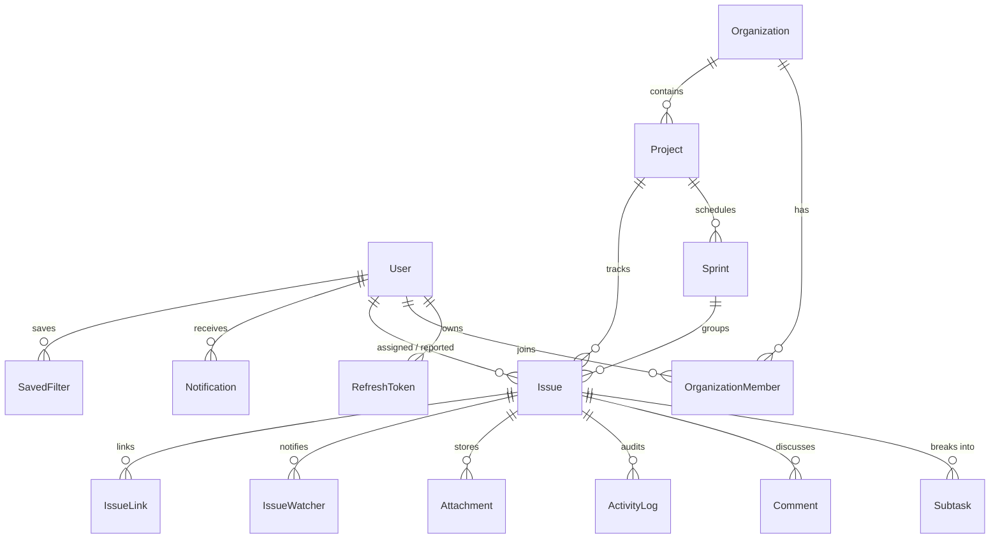

# Arij — Enterprise Issue Tracking & Agile Project Management Platform

Arij is a full-stack Jira-like issue tracking and agile project management platform built with **React 19, TypeScript/JavaScript, Vite, Tailwind CSS, Express, PostgreSQL + Prisma ORM, Zod validation, JWT Auth, and Mozilla `pdfjs-dist` dynamic PDF text extraction**.

---

## 1. Architecture Plan

```
┌─────────────────────────────────────────────────────────────────────────┐
│                        FRONTEND (React 19 + Vite)                       │
│  • Kanban Board, Backlog, List Navigator, Sprint Burndown & Epics View  │
│  • Client-Side PDF.js Coordinate Text Extractor (pdfTextExtractor.js)   │
│  • Dynamic Story & PRD Section Parser (storyTextParser.js)              │
│  • Real-Time Server-Sent Events (SSE) Sync + Keyboard Shortcuts (C, /)  │
└───────────────────────────────────┬─────────────────────────────────────┘
                                    │ REST API + SSE (/api/*)
┌───────────────────────────────────▼─────────────────────────────────────┐
│                     BACKEND (Node.js + Express + Zod)                   │
│  • JWT Access & Refresh Tokens + PBKDF2 Password Hashing                │
│  • Organization & Project RBAC Middleware (ADMIN, MEMBER, VIEWER)       │
│  • Zod Input Validation + Paginated Endpoints (?page=1&limit=20)        │
│  • Configurable Project Workflows & Allowed Status Transitions          │
│  • OpenAPI 3.1 / Swagger Spec (/api/docs/openapi.json)                  │
└───────────────────────────────────┬─────────────────────────────────────┘
                                    │
┌───────────────────────────────────▼─────────────────────────────────────┐
│          PERSISTENCE LAYER (PostgreSQL 16 + Prisma / JSON Engine)       │
│  • Prisma Schema (prisma/schema.prisma) + Docker Compose PostgreSQL     │
│  • Atomic Mutex State Persistence + Optional Firebase Spark Free Sync   │
└─────────────────────────────────────────────────────────────────────────┘
```

---

## 2. Database Entity-Relationship (ER) Diagram



---

## 3. Phases & Key Modules

| Phase | Capabilities | Key Files |
| :--- | :--- | :--- |
| **Phase 1: Core & Dynamic PDF Extraction** | JWT Sign Up / Login / Logout / Refresh, Organizations & RBAC (`ADMIN`, `MEMBER`, `VIEWER`), Projects with unique keys & auto-incrementing counters, Issues CRUD + inline editing, and **100% dynamic PDF text extraction (`pdfjs-dist`)** | `prisma/schema.prisma`, `src/utils/pdfTextExtractor.js`, `src/utils/storyTextParser.js`, `src/utils/apiSchemas.js` |
| **Phase 2: Workflow & Boards** | Configurable workflow per project (`workflowConfig.allowedTransitions`), interactive Kanban board with drag-and-drop status updates, Backlog & List views with sorting, multi-faceted filters, and global search (`/api/search`) | `src/components/BoardView.jsx`, `src/components/BacklogView.jsx`, `src/components/IssuesNavigatorView.jsx` |
| **Phase 3: Collaboration** | Comments with `@mentions` auto-detection, chronological Activity/Audit log per issue, Attachments with 10 MB size & MIME validation, Watchers, In-App Notifications, and Issue Links (`BLOCKS`, `IS_BLOCKED_BY`, `RELATES_TO`) | `src/components/IssueDetailModal.jsx`, `src/components/UserAccountAndNotificationsModals.jsx` |
| **Phase 4: Planning** | Sprint creation, start, and completion (moving unfinished issues to backlog or next sprint), Sprint Board, Burndown Chart, Epics progress bars, and Created vs. Resolved / Assignee Workload reports | `src/components/ReportsView.jsx`, `src/components/TimelineView.jsx` |
| **Phase 5: Polish & OpenAPI** | Saved filters/custom views, Keyboard shortcuts (`C` to create issue, `/` to search, `?` for help), Dark mode, responsive layout, and OpenAPI 3.1 specification (`/api/docs/openapi.json`) | `src/components/EnterpriseAndDevView.jsx`, `playwright.config.ts`, `tests/e2e/arij.spec.ts` |

---

## 4. Setup & Verification Commands

### Run Locally (Node.js)
```bash
npm install
npm run dev
# App runs on http://localhost:3000
```

### Run with Docker Compose (PostgreSQL 16 + App)
```bash
docker compose up --build -d
npx prisma generate
npx prisma migrate dev --name init
```

### Run Unit & Playwright E2E Tests
```bash
# Run dynamic PDF text parser unit tests (verifies zero hardcoding)
node tests/unit/storyTextParser.test.js

# Run Playwright E2E test suite
npx playwright test
```
